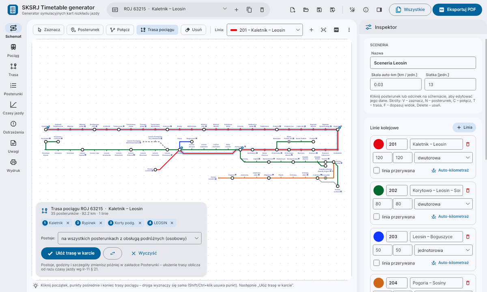
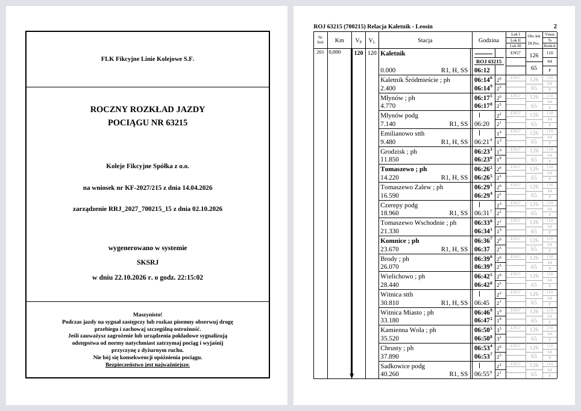
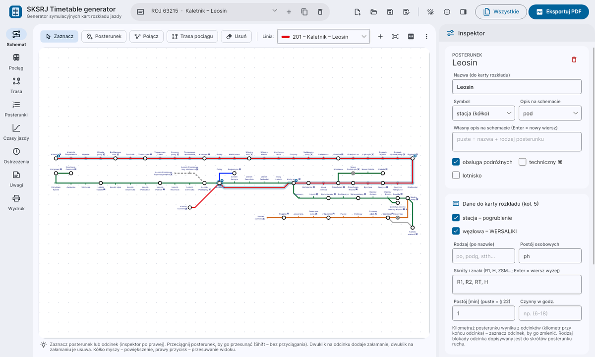
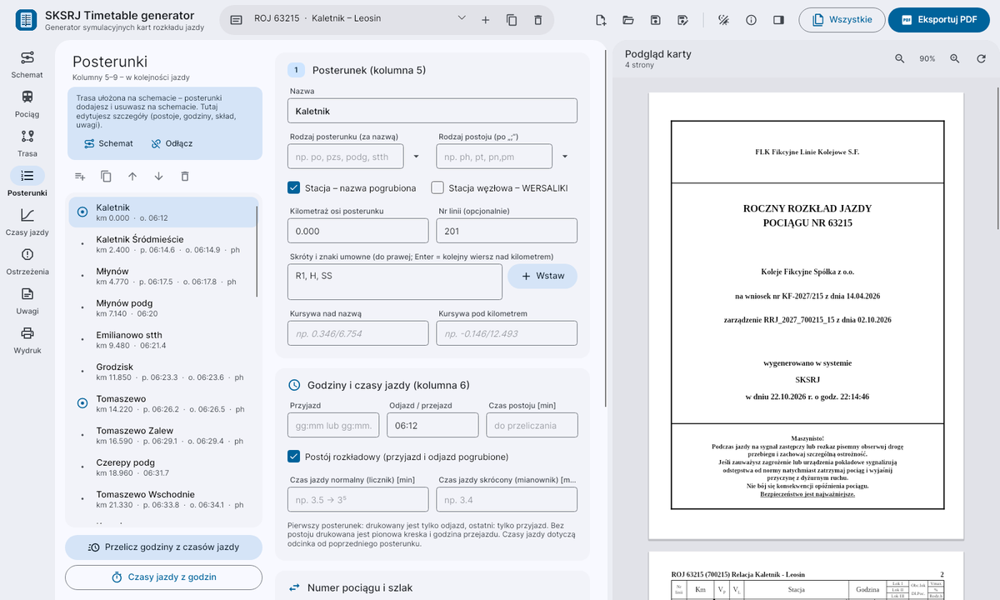
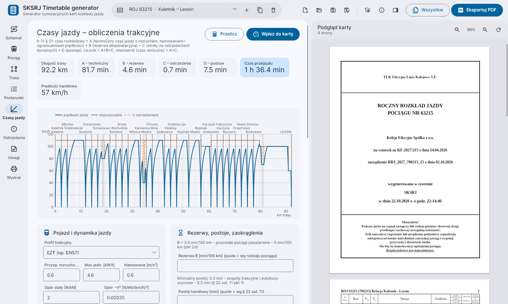
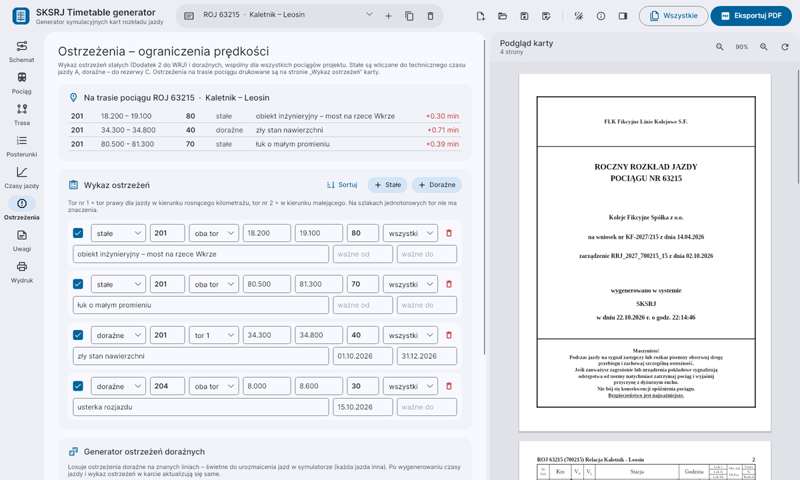
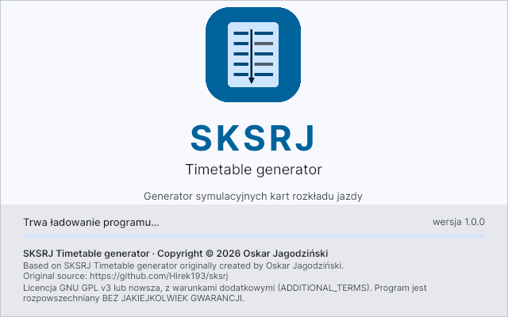
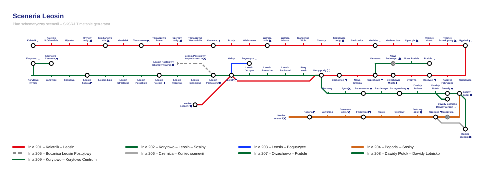

# SKSRJ Timetable generator

**English** · [Polski](README.pl.md)

**Simulation timetable card generator** – a desktop application (C#, .NET 8, Avalonia 11,
Material Design 3 style UI) for creating **Polish railway service timetables (*karty rozkładu jazdy*)
as PDF files** for train simulators such as [MaSzyna](https://eu07.pl).

The cards reproduce the template from the *Instrukcja o rozkładzie jazdy pociągów Ir-11*
(PKP PLK S.A., 2021 – § 32, Appendices 4 and 5). Train routes are laid out on a **schematic scenery map**,
and running times are calculated according to **Ir-11 § 21**, taking **permanent and temporary speed
restrictions** into account. The program works with both real and **fictional** routes.

The user interface and the generated cards are in Polish, as in the original instruction.



> **Note:** this program is intended for simulation purposes only. It is not affiliated with or
> endorsed by PKP Polskie Linie Kolejowe S.A. and must not be used to operate real railway traffic.

---

## Contents

- [Features](#features)
- [Screenshots](#screenshots)
- [Installation](#installation)
- [Using the program](#using-the-program)
- [Running time calculation](#running-time-calculation-ir-11--21)
- [Project file format](#project-file-format)
- [Command-line tool](#command-line-tool)
- [Repository layout](#repository-layout)
- [License and authorship](#license-and-authorship)

## Features

### Timetable card (PDF)

- **Title page** per Appendix 5: issuer, timetable type, “POCIĄGU NR …” (train no.), railway undertaking,
  application, order (with a signature generator per § 35), “wygenerowano w systemie … w dniu … r. o godz. …”
  (generated in system … on … at …), and the “Maszynisto!” (Driver!) footer.
- **Detailed timetable pages** with a header and 9 columns:
  line no. · km of speed changes (changes on the track the timetable is built for in bold) · V<sub>P</sub> ·
  V<sub>L</sub> (merged on single-track sections) · station (bold stations, junction stations in capitals,
  kilometre, abbreviations and symbols, line-change kilometrage in italics) · time (tenths of a minute as
  superscript, “|” for passing, train-number change box, normal/shortened running times) · Loco I/II/III ·
  load and length · Vmax / brake % / brake type (unchanged values in grey).
- **Direction arrow** (right / left track), **line marker** (single / double track),
  **footnotes** \*1), \*2) on the pages where they are used, **“Kursuje:”** (runs on) and
  **“Uwagi do rozkładu”** (remarks).
- **“Wykaz ostrzeżeń na trasie pociągu”** page (speed restrictions on the train's route) with the time
  lost on each restriction.
- Page breaks that keep line sections continuous; **A5** sheets or **A4 landscape – 2×A5**.
- Times New Roman, as on SKRJ cards, taken from the system when installed (embedded as a subset in the PDF); otherwise the bundled Liberation Serif, which is metric-compatible, so the layout is identical.



### Scenery schematic

- Multiple railway lines: number, name, colour, dashed style, default speeds, single/double track.
- Posts: station (circle), halt / block post (tick), closed (crossed out), end of line;
  icons for passenger service, technical post ⌘ and airport.
- Sections drawn at 0/45/90° (5 styles) with any number of bends, kilometrage at both ends,
  V<sub>P</sub>/V<sub>L</sub> speed changes, block system, electrification, sidings avoided in route finding.
- **Line renumbering** – changes the line number on the schematic and in every card, restriction and post restriction that refers to it.
- **Inspector**: metadata of the selected post (name, type, bold / capitals, abbreviations, default stop,
  dwell time, opening hours, platforms, notes), section or line.
- **Post speed restrictions** – for a chosen line, km range and track (e.g. station throat geometry,
  turnouts): either written into card columns 3–4 or added as an entry in the list of permanent restrictions.
- **Dark mode for the schematic** – toggle on the toolbar (PDF export stays light).
- **Automatic kilometrage** of a line from the drawing length, export of the schematic to PDF (A3) with a legend.
- **Import of MaSzyna timetables** (text `*.txt` files from a scenery's timetable folder): posts, kilometrage, speeds, abbreviations and single/double track are added to the schematic as a line, and optionally a train card is created with the times, running times and consist from the file.
- **Standalone schematic files** (`*.sksrjs`) – export the schematic and import it into another project (a schematic can also be imported from a `*.sksrj` project).

### Train route from the schematic

Click the start, intermediate points and the end on the schematic – the path is found automatically
(shortest, preferring to stay on the same line). “Ułóż trasę w karcie” (lay out route in the card) creates
the line sections and every post along the way, sets stops according to the selected rule (stopping train /
semi-fast / selected points only / no intermediate stops) and immediately calculates running times.
Passenger halts get the “po” type, and the “ph” commercial stop mark appears only where a passenger train
actually stops; halts the train passes without stopping are not printed on the card (they remain in the
post list, and the running time covers the whole stretch to the next printed post). Changing the stop rule updates the card straight away. The **Posterunki** (posts) and
**Trasa** (route) tabs are then used to fine-tune details (e.g. running on the left track); manual changes are
remembered and not overwritten when the route is laid out again. Each stretch between two posts is a separate
section, so the right / left track can be chosen for any part of the route – on the card, consecutive sections
of the same line are printed together and the arrow switches columns where the track changes. Speeds in the
V<sub>P</sub>/V<sub>L</sub> columns are capped at the train's maximum speed (Vmax), as required by
Ir-11 § 32(6)(2)(e) and (f).

### Speed restrictions

A list of **permanent** restrictions (included in the technical running time) and **temporary** ones
(reserve C) – line, track, km from–to, speed, train types, reason, validity – plus a **temporary restriction
generator** (random, optionally seeded) to add variety to simulator runs.

## Screenshots

| Post inspector | Train posts |
|---|---|
|  |  |

| Running times and v(s) chart | Speed restrictions |
|---|---|
|  |  |

| Start screen | Schematic as PDF |
|---|---|
|  |  |

## Installation

### Ready-made Windows build

Download the package from *Releases* (or build it yourself – see below), unpack it and run `SKSRJ.exe`.
Every push to `main` is built automatically by GitHub Actions (`.github/workflows/prerelease.yml`) and published as a **prerelease** `build-1.0.<n>` with a Windows package (needs .NET 8), a standalone Windows `.exe`, a Linux build and the sample cards; the last 10 prereleases are kept.
The [.NET 8 Desktop Runtime](https://dotnet.microsoft.com/download/dotnet/8.0) (x64) is required.

### From source

Requires the [.NET 8 SDK](https://dotnet.microsoft.com/download/dotnet/8.0).

```bash
git clone https://github.com/Hirek193/sksrj.git
cd sksrj
dotnet run --project src/Sksrj.App
```

Publishing:

```bash
# requires the .NET 8 Desktop Runtime to be installed
dotnet publish src/Sksrj.App -c Release -r win-x64 --self-contained false -p:DebugType=none -o dist/SKSRJ

# self-contained single executable (no .NET installation needed)
dotnet publish src/Sksrj.App -c Release -r win-x64 --self-contained true -p:PublishSingleFile=true \
  -p:IncludeNativeLibrariesForSelfExtract=true -p:EnableCompressionInSingleFile=true -p:DebugType=none -o dist/win-x64
```

The same works with `-r linux-x64` or `-r osx-arm64`.

## Using the program

| Section | Contents |
|---|---|
| **Schemat** (schematic) | scenery map, drawing tools, inspector, laying out the train route |
| **Pociąg** (train) | train category and number, system number generated as in MaSzyna scripts (`hash(scenario[:5]) % 299 + 1`), relation, header (with an “auto” fill button), title page, “today” buttons for dates, order signature, footer; a **bank** of issuer headers and railway undertakings saved for reuse |
| **Trasa** (route) | line sections (columns 1–4): km, V<sub>P</sub>/V<sub>L</sub> speeds, right/left track |
| **Posterunki** (posts) | posts (columns 5–9): name, km, abbreviations, italics, times, running times, train number, consist; batch setting of commercial stop times for halts, stations and junction stations (select all / none) |
| **Czasy jazdy** (running times) | traction profile, reserves, v(s) chart, A/B/C/D results, writing times into the card |
| **Ostrzeżenia** (restrictions) | permanent and temporary restrictions, generator, restrictions on the train's route |
| **Uwagi** (remarks) | “Kursuje:”, footnotes, timetable remarks |
| **Wydruk** (print) | A5 / A4 2×A5, restriction list, grey background for commercial stop (ph) times, “simulation timetable” note, project, theme |

**Keyboard shortcuts:** `Ctrl+N` new project · `Ctrl+O` open · `Ctrl+S` save · `Ctrl+Shift+S` save as ·
`Ctrl+E` export PDF · `F5` refresh preview.
**On the schematic:** `V` select · `N` post · `C` connect · `T` route · `F` fit view · `Delete` delete ·
`Esc` cancel · mouse wheel – zoom · right button – pan · double-click on a section – add a bend ·
`Shift` – no grid snapping.

**Data entry tips**

- Times: `06:28`, `06:28.1` (→ 06:28¹), `06:28:30`; running times: `3`, `3.5` (→ 3⁵).
- A post can have two kilometre values where lines meet, e.g. `8.317/1.558`.
- Multi-line abbreviations – press Enter in the abbreviations field; the last line is printed next to the kilometre.
- Empty consist fields = unchanged from the previous post (printed in grey on the card).
- Track no. 1 = the right-hand track when travelling towards increasing kilometrage.

## Running time calculation (Ir-11 § 21)

| Component | Method |
|---|---|
| **A** – technical running time | motion integrated every 10 m: acceleration (limited by power per tonne and running resistance), service braking, permitted speeds, permanent restrictions, train Vmax and train length |
| **B** – operating reserve | per § 21(6)(2): EIJ 2.5; EC/EN/EI/MH/MM/MP/RP 3; TC/TD 3; other passenger 5; freight and maintenance 7; non-commercial 5; light engine 3 min/100 km (or a custom value) |
| **C** – modernisation reserve | time lost on temporary restrictions |
| **D** – stops | minimum per § 22(11) (0.5 min; 0.3 min for multiple units; 1 min for MP/MM with coaches; 2 min with sleeping cars) or as entered |

Numerator (normal time) = A+B+C, denominator (shortened time) = A+C. Times are rounded per § 21(9)
(origin and destination stations – whole minutes, junction stations – 0.5 min, others – 0.1 min).
10 traction profiles are available (EN57, Elf, SA, ED250, EU07/EP09 with coaches, ET22 with 2000 t,
intermodal train, light engines). The traction model is simplified – results are estimates for simulation use.

## Project file format

`*.sksrj` is human-readable JSON: `TimetableProject` → `Scenery` (lines, posts, sections),
`Restrictions` and `Timetables[]` (cards: line sections, posts, footnotes, route on the schematic,
calculation parameters). The format is easy to generate from other tools, e.g. from scenery data.

The sample project (loaded at start-up, also in `samples/`) contains the Kaletnik – Rypinek – Leosin – Sosiny
scenery schematic (9 lines, 82 posts), two trains laid out on the schematic (stopping train ROJ 63215 and
freight train TME 44210), sample restrictions, a manually entered card, and a reproduction of the sample
card from Appendix 5 to Ir-11.

## Command-line tool

```bash
dotnet run --project tools/Sksrj.Cli -- project.sksrj output.pdf [index|all] [a5|a4]   # cards
dotnet run --project tools/Sksrj.Cli -- --scheme project.sksrj scheme.pdf             # schematic
dotnet run --project tools/Sksrj.Cli -- --sample directory                            # samples
```

## Repository layout

```
src/Sksrj.Core     data model, Ir-11 dictionaries, card layout (Layout/), schematic, routing,
                   traction calculations and restrictions (Engine/), PDF export (Pdf/)
src/Sksrj.App      Avalonia application (MVVM), Material Design 3 theme (Styles/), views (Views/)
tools/Sksrj.Cli    PDF generation from the command line
samples/           sample project and PDFs generated from it
docs/img/          screenshots
```

## License and authorship

**SKSRJ Timetable generator** – Copyright © 2026 Oskar Jagodziński.

This program is free software: you can redistribute it and/or modify it under the terms of the
[GNU General Public License](LICENSE) version 3 or (at your option) any later version, together with the
[additional terms](ADDITIONAL_TERMS) under Section 7 of that License. In short, the additional terms require:

1. **preserving the attribution** in the source files and in the program's legal notices (in the user
   interface – in an easily accessible place, e.g. the start screen or the “About” window):

   ```
   Based on SKSRJ Timetable generator originally created by Oskar Jagodziński.
   Original source: https://github.com/Hirek193/sksrj
   ```

2. **clearly marking modified versions** as different from the original,
3. **not using the name “SKSRJ Timetable generator” or its logo** as the name of a modified version
   without the author's written permission.

The program is distributed **without any warranty**. Full texts: [`LICENSE`](LICENSE),
[`ADDITIONAL_TERMS`](ADDITIONAL_TERMS). Licenses of the libraries and fonts used (MIT, Apache 2.0,
SIL OFL 1.1) are listed in [`THIRD-PARTY-NOTICES.md`](THIRD-PARTY-NOTICES.md); they are also available
in the program (ⓘ “O programie” / About button).

The layout of the timetable cards and the dictionaries of symbols and abbreviations are based on the Ir-11
instruction; the rights to the instruction belong to PKP Polskie Linie Kolejowe S.A.
